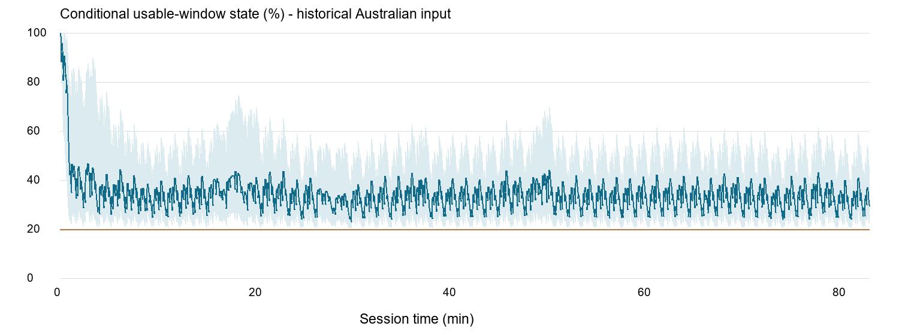
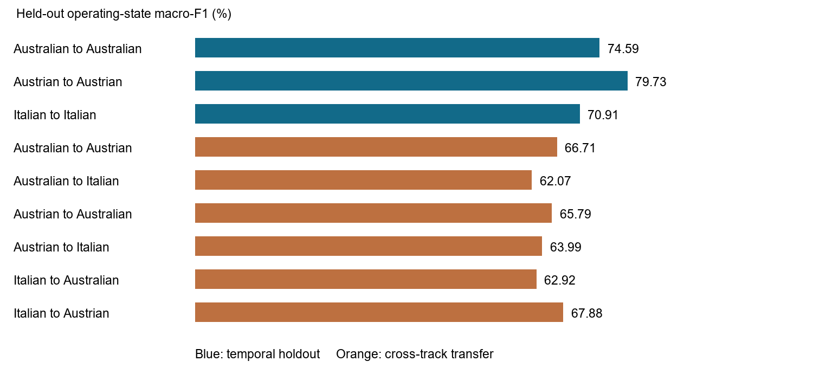

# Abstract

Public Formula 1 telemetry describes vehicle motion but does not expose battery current, voltage or the internal combustion engine–motor power split. This project develops a mathematics-guided framework for conditional energy recovery system (ERS) state estimation and constrained deployment analysis for Kimi Antonelli’s 2026 telemetry. A longitudinal road-load model generates signed wheel-power demand; explicit deployment and regeneration assumptions then propagate energy continuously across laps within a modeled usable window. The initial state is imposed at 100%, and a reserve-aware policy prevents assumed deployment from consuming the configured reserve. A separate histogram-based gradient-boosting classifier identifies four contemporaneous driving states from speed, RPM, gear and derived acceleration. Three race datasets support temporal and cross-circuit classification experiments. A gradient-based constrained optimizer reallocates an Australian-lap baseline against a speed-weighted energy proxy. Temporal classification accuracy is 87.98–90.72%, while cross-track accuracy is 80.04–85.91%; these scores do not measure ERS accuracy. A stored reserve-aware optimization increases the proxy from 1.31313 to 1.52988 at essentially identical delivered energy. Continuous accounting exhibits a maximum conservation residual of 8.55 × 10^-13 MJ in the historical Australian input. The contribution is an auditable integration of energy accounting, explicit assumptions, leakage-aware ML evaluation and constrained allocation. True battery-state accuracy, race-time improvement and event-specific regulatory compliance remain unestablished.

Keywords: Formula 1; ERS; conditional state estimation; energy accounting; gradient boosting; constrained optimization; identifiability.

# 1 Introduction

ERS strategy couples electrical energy availability to propulsion and braking opportunities. An observer using public telemetry can inspect speed, throttle and braking, but cannot directly measure the electrical energy exchanged inside the power unit. Reconstructing a battery trace from these observations is therefore an inverse problem with missing information. A smooth, physically bounded trace can be useful for analysis while still being inconsistent with the actual hidden power split.

Prior race-car control studies formulate energy management using explicit powertrain models and resource constraints [1]–[5]. Battery estimation research combines electrical observations, state models and learned mappings [6]–[9]. This project investigates the more restricted setting in which these battery measurements are unavailable. Mathematical transparency is consequently as important as predictive performance.

The system combines three distinct tasks: conditional usable-energy propagation, telemetry-based operating-state classification, and hypothetical deployment allocation. Keeping these tasks separate prevents classification performance from being misinterpreted as battery-state validation. The report evidence cutoff is 2 November 2026. This is the inspection cutoff, not a verified assertion that every upstream session through that date has been downloaded.

## 1.1 Problem statement

Given irregularly sampled public telemetry and uncertain vehicle parameters, construct a continuous, bounded ERS usable-energy scenario; evaluate an ancillary driving-state classifier without adjacent-sample leakage; and explore deployment allocation under explicit energy and power constraints. Determine which conclusions follow from numerical consistency and which require independent electrical measurements.

## 1.2 Objectives

1. Preserve source identity, units, chronology and missing-data information during preprocessing.
2. Derive a signed longitudinal power demand and propagate conditional energy without resetting at lap boundaries.
3. Expose parameter assumptions, scenario dependence and structural non-identifiability.
4. Train and evaluate operating-state classification using chronological and cross-track partitions.
5. Solve a gradient-based constrained allocation problem and compare it with an energy-matched baseline.
6. Provide an interactive engineering dashboard and reproducible evidence exports.

## 1.3 Scope

The intended acquisition scope is all available Antonelli 2026 sessions at a frozen cutoff. Completed modeling and classification evidence currently covers Australian, Austrian and Italian GP race imports. The supplied archive additionally contains preprocessing material for other sessions; availability of those files is not evidence that every session was modeled or evaluated. Proprietary power-unit identification, measured battery SoC reconstruction, thermal modeling and demonstrated lap-time optimization are outside the completed scope.

# 2 Literature Review

The supplied 12-paper survey provides the starting bibliography. Recent racing energy-management and battery-estimation work is prioritized; the 2017 race-car controller and 2020 neural-network/filter study provide methodological foundations. The review is a selected analytical review rather than a systematic review with a documented exhaustive search.

## 2.1 Racing energy management

Salazar et al. [1] establish a model-based optimal-control foundation. Duhr et al. [2] couple gear selection with energy management using convex modeling, dynamic programming and Pontryagin’s minimum principle in a Bahrain case study. Their formulation illustrates why RPM and gear matter jointly, but presumes a powertrain model unavailable to an external telemetry observer. Battery path constraints [3] and race-level allocation [5] motivate explicit state limits and a carefully chosen horizon. Javed and Samuel [4] compare model-based energy optimization with dynamic programming and rule-based control in simulation. These works support constrained allocation methods; their simulated performance is not a benchmark for public-data battery inference.

## 2.2 Battery estimation and machine learning

Neural-network/filter combinations [6], robust EKF estimation [7] and ML surveys [8] represent complementary approaches to battery state estimation. Their model and measurement requirements must be checked before transfer to F1 telemetry. Pillai et al. [7] address parameter uncertainty using additional states and innovation diagnostics, demonstrated with a battery simulator. Sun et al. [9] use real operating EV data and a CNN–BiLSTM–attention architecture with battery-pack information. Such electrical inputs are absent here. Replacing those inputs with vehicle speed does not establish an equivalent estimation problem.

## 2.3 The 2026 context and research gap

Regulation-oriented studies [10]–[12] explain changes in energy-management demands. Gaur [11] uses 2024 qualifying telemetry for scenario analysis of three circuits; those data are not measured 2026 battery traces. Regulatory commentary must be checked against the relevant FIA issue [13], [14]. Descriptive power-share statements in secondary literature are not imposed here as a universally mandated instantaneous engine/electric split.

The defensible gap is an auditable public-telemetry workflow that distinguishes feasible conditional energy histories from measured battery state, keeps energy continuous across laps, and evaluates a separate ML task across circuits. The work does not claim the first F1 energy optimizer or the first physics-informed battery estimator.

## 2.4 Literature comparison

The following compact comparison records the validation setting without importing unrelated numerical scores into this project. Where only a supplied survey or bibliographic record was accessible, detailed experimental sample counts and performance claims are deliberately omitted.

### Study 1

| S.No. | Author & Year | Paper Title |
| --- | --- | --- |
| 1 | Mauro Salazar et al.; Nov 2017 | Time-optimal control policy for a hybrid electric race car [1] |

| Objective / Problem | Methodology / Technique | Dataset / Sample |
| --- | --- | --- |
| Hybrid race-car energy allocation | Optimal-control policy / Pontryagin analysis | Modeled race car; simulation |

| Key Findings | Limitations / Research Gap | Relevance to Our Work |
| --- | --- | --- |
| Constrained allocation is tractable | Requires internal model; older architecture | Foundation for dynamic energy constraints |

### Study 2

| S.No. | Author & Year | Paper Title |
| --- | --- | --- |
| 2 | Pol Duhr et al.; 15 Jan 2021 | Time-optimal gearshift and energy management strategies for a hybrid electric race car [2] |

| Objective / Problem | Methodology / Technique | Dataset / Sample |
| --- | --- | --- |
| Joint gear and energy control | Convex modeling, DP and Pontryagin iteration | Bahrain model-based case study |

| Key Findings | Limitations / Research Gap | Relevance to Our Work |
| --- | --- | --- |
| Gear and energy decisions interact | Not hidden-state reconstruction | Motivates joint RPM/gear features |

### Study 3

| S.No. | Author & Year | Paper Title |
| --- | --- | --- |
| 3 | Pol Duhr et al.; 29 Jun–2 Jul 2021 (conference) | Time-optimal Energy Management of the Formula 1 Power Unit with Active Battery Path Constraints [3] |

| Objective / Problem | Methodology / Technique | Dataset / Sample |
| --- | --- | --- |
| Active battery-state limits | Optimal control with battery path constraints | Modeled F1 power unit |

| Key Findings | Limitations / Research Gap | Relevance to Our Work |
| --- | --- | --- |
| State bounds affect the control policy | Independent telemetry-state validation absent | Motivates per-sample energy constraints |

### Study 4

| S.No. | Author & Year | Paper Title |
| --- | --- | --- |
| 4 | Hassan Javed et al.; 30 Aug 2022 | Energy Optimal Control for Formula One Race Car [4] |

| Objective / Problem | Methodology / Technique | Dataset / Sample |
| --- | --- | --- |
| Energy-optimal power split | GT-Suite, discrete/genetic optimization; DP reference | High-fidelity simulator |

| Key Findings | Limitations / Research Gap | Relevance to Our Work |
| --- | --- | --- |
| Model-based control compared with baselines | Older ERS architecture; model-dependent | Supports explicit cost and baseline |

### Study 5

| S.No. | Author & Year | Paper Title |
| --- | --- | --- |
| 5 | Pol Duhr et al.; Jun 2023 | Minimum-Race-Time Energy Allocation Strategies for the Hybrid-Electric Formula 1 Power Unit [5] |

| Objective / Problem | Methodology / Technique | Dataset / Sample |
| --- | --- | --- |
| Race-level energy allocation | Race-time energy-management optimization | Modeled hybrid F1 power unit |

| Key Findings | Limitations / Research Gap | Relevance to Our Work |
| --- | --- | --- |
| Extends allocation beyond an isolated lap | Requires performance and powertrain models | Clarifies limits of selected-lap replay |

### Study 6

| S.No. | Author & Year | Paper Title |
| --- | --- | --- |
| 6 | Seyedmehdi Hosseininasab et al.; 18 Nov–16 Dec 2020 (conference) | State-of-Charge Estimation of Lithium-ion Battery Based on a Combined Method of Neural Network and Unscented Kalman Filter [6] |

| Objective / Problem | Methodology / Technique | Dataset / Sample |
| --- | --- | --- |
| Battery SoC estimation | Neural network plus unscented Kalman filter | Battery estimation study; exact sample count not audited |

| Key Findings | Limitations / Research Gap | Relevance to Our Work |
| --- | --- | --- |
| Combines learned mapping and filtering | Electrical-data requirements differ | Future option with independent labels |

### Study 7

| S.No. | Author & Year | Paper Title |
| --- | --- | --- |
| 7 | Prarthana Pillai et al.; Published online 5 Dec 2023; journal issue Jul 2024 | A Robust Extended Kalman Filtering Approach for State of Charge Estimation in Batteries [7] |

| Objective / Problem | Methodology / Technique | Dataset / Sample |
| --- | --- | --- |
| Robust battery state estimation | Augmented robust EKF and innovation diagnostics | Battery simulator |

| Key Findings | Limitations / Research Gap | Relevance to Our Work |
| --- | --- | --- |
| Addresses model-parameter uncertainty | Simulator validation; battery model needed | Motivates discrepancy diagnostics |

### Study 8

| S.No. | Author & Year | Paper Title |
| --- | --- | --- |
| 8 | Aya Haraz et al.; 28 Oct 2024 | State-of-Health and State-of-Charge Estimation in Electric Vehicles Batteries: A Survey on Machine Learning Approaches [8] |

| Objective / Problem | Methodology / Technique | Dataset / Sample |
| --- | --- | --- |
| Review ML battery SoC/SoH | Survey of ML approaches | Published studies; not a new F1 dataset |

| Key Findings | Limitations / Research Gap | Relevance to Our Work |
| --- | --- | --- |
| Organizes learning-based approaches | Task/data heterogeneity | Guides label and input requirements |

### Study 9

| S.No. | Author & Year | Paper Title |
| --- | --- | --- |
| 9 | Changcheng Sun et al.; 2024 | Data-driven state-of-charge estimation of a lithium-ion battery pack in electric vehicles based on real-world driving data [9] |

| Objective / Problem | Methodology / Technique | Dataset / Sample |
| --- | --- | --- |
| Real-world battery-pack SoC | CNN–BiLSTM–attention; cell inconsistency features | Actual operating EV data |

| Key Findings | Limitations / Research Gap | Relevance to Our Work |
| --- | --- | --- |
| Uses pack information for estimation | Battery-specific inputs unavailable here | Shows what independent validation needs |

### Study 10

| S.No. | Author & Year | Paper Title |
| --- | --- | --- |
| 10 | Oliwia Kropisz et al.; Online 5 Mar 2026; issue publication 2 Jul 2026 | Impact of 2026 FIA technical regulations on Formula 1 power units, aerodynamics and energy management [10] |

| Objective / Problem | Methodology / Technique | Dataset / Sample |
| --- | --- | --- |
| 2026 design implications | Regulation and engineering analysis | Published technical sources |

| Key Findings | Limitations / Research Gap | Relevance to Our Work |
| --- | --- | --- |
| Connects PU and aero changes | Not synchronized battery measurements | Context; no transferred vehicle parameters |

### Study 11

| S.No. | Author & Year | Paper Title |
| --- | --- | --- |
| 11 | Anushka Gaur; 29 Jun 2026 | Strategic Implications of Driver-Controlled Energy Deployment in the 2026 Formula One Power Units [11] |

| Objective / Problem | Methodology / Technique | Dataset / Sample |
| --- | --- | --- |
| Circuit-dependent deployment | Braking/straight energy calculations | 2024 qualifying telemetry; Baku, Monza, Silverstone |

| Key Findings | Limitations / Research Gap | Relevance to Our Work |
| --- | --- | --- |
| Shows scenario dependence across circuits | Student study; assumed flows; older telemetry | Context for cross-circuit scenarios |

### Study 12

| S.No. | Author & Year | Paper Title |
| --- | --- | --- |
| 12 | Jiashu Xu; 7 Nov 2023 | Thermodynamic evaluation of 2026 Power Unit technical regulation changes in Formula 1 [12] |

| Objective / Problem | Methodology / Technique | Dataset / Sample |
| --- | --- | --- |
| 2026 PU regulation changes | Thermodynamic and regulation comparison | 2023/2026 regulation comparison |

| Key Findings | Limitations / Research Gap | Relevance to Our Work |
| --- | --- | --- |
| Discusses changed energy architecture | Conceptual analysis; not empirical SoC validation | Background; verify current rules separately |

# 3 Dataset and Exploratory Analysis

## 3.1 Source and provenance

The telemetry source is TracingInsights/2026 [15]. The newer importer pins commit e8cf4fe5121447409fa0cb3728255f261cfc8d62 and preserves source JSON bytes, URLs and checksums. It selects event/Race/ANT lap telemetry, laptimes and session metadata. Original lap identifiers and original lap start times are retained. The historical Australian CSV is separately identified by SHA-256 9f12948c5da1f8386f4b6ba4c36c0795d82ddbc39a954b4879375b6095171b21; its results must not be silently relabeled as results from the newer import.

Table 1. Completed race-import coverage reported by the multi-track implementation and associated experiment artifacts.

| Race | Samples | Laps | Driver | Analysis role |
| --- | --- | --- | --- | --- |
| Australia | 37,569 | 58 | ANT | Temporal and cross-track ML; energy scenarios |
| Austria | 39,416 | 71 | ANT | Temporal and cross-track ML; energy scenarios |
| Italy | 36,453 | 53 | ANT | Temporal and cross-track ML; energy scenarios |

These imports total 113,438 records and 182 race laps. Broader acquisition/preprocessing coverage remains separate from this evaluated subset. No complete season-wide session manifest was established for this report.

## 3.2 Data dictionary

| Field | Meaning and use | Units / caveat |
| --- | --- | --- |
| time / session_time | Chronology and integration intervals | Seconds; newer import uses original lap start offsets |
| lap_number / lap_time | Original lap identity and local timing | Available in newer import; historical laps inferred |
| speed | Road-load and ML input | km/h; convert to m/s |
| rpm; gear | Operating context and classifier input | rpm; integer gear |
| throttle; brake | State-label construction and flow gates | Percent throttle; binary brake in audited race CSV |
| distance; rel_distance | Lap-position selection and checks | Metres; fraction |
| acc_x/y/z | Source acceleration context | Units/processing not independently calibrated |
| x/y/z | Recorded trajectory display | Source coordinate units unverified |
| DistanceToDriverAhead | Traffic context | Source distance convention; not electrical input |

No channel supplies battery current, terminal voltage, temperature, usable capacity, true SoC, measured motor power or a calibrated ICE map.

## 3.3 Preprocessing

The original fetch/preprocessing scripts and newer race adapter form different data stages. The original fetcher discarded lap IDs and assembled cumulative time from lap durations. Historical race laps are inferred when relative distance wraps from above 0.75 to below 0.25. The newer importer instead preserves original IDs and uses original lap starts plus lap-local time; it rejects missing lap files, noncontiguous IDs, mismatched arrays and reversed timestamps. This preserves long interruptions rather than compressing them.

Numerical conversion preserves invalid/missing values as null. Signals are checked for finite values, diagnostic ranges, chronology, duplicates and gaps. DriverAhead, when present, is categorical and its None value represents missing context. Diagnostic plausibility thresholds are flags, not proven physical limits. Strong braking is retained rather than deleted merely for its magnitude.

Speed is converted using v = speed/3.6. Acceleration is a causal least-squares slope over the preceding 0.6 s, requiring at least two valid points spanning more than 0.05 s. Fits do not cross gaps longer than 0.5 s. This derivative uses data through the current endpoint; it does not forecast future acceleration. Integration uses actual irregular intervals, not a fixed sampling frequency.

## 3.4 Exploratory findings

The historical Australian summary records 57 duplicate timestamps, five large gaps, zero invalid timestamps and 58 inferred laps. Equal-time boundary records contribute zero transferred energy. Recorded missing counts are zero for the listed numeric fields, but derivative availability and unsupported time gaps still affect modeling. The unknown modeled duration is 3.436 s.

Speed-integrated distance and recorded distance provide an independent numerical diagnostic, not a surveyed track calibration. For historical lap 2 the integrated distance is 5,148.002 m versus a recorded span of 5,146.269 m, a difference of 1.733 m. Other laps have larger discrepancies; they must not all be interpreted as a constant offset. Source-coordinate plots preserve row correspondence but cannot establish physical alignment to circuit graphics.

Figure 1 shows the historical race’s conditional energy history and limited scenario spread. Figure 2 compares classification results. These plots describe actual saved outputs; scenario values are not observations of the car battery.

# 4 Mathematical Formulation

## 4.1 Longitudinal power demand

For speed v (m/s), acceleration a (m/s²), mass m (kg), air density rho (kg/m³), effective drag area CdA (m²), rolling coefficient Crr and g = 9.80665 m/s²:

F_req = m a + 0.5 rho CdA v² + Crr m g.                         (1)

P_w = F_req v / 1000 [kW].                                    (2)

Positive P_w represents propulsion demand; negative P_w represents net braking demand after the modeled road loads. Constant mass and effective aero are assumed. Grade, wind, fuel-burn variation, drivetrain losses and lateral tyre dynamics are omitted. These omissions can be mistaken for ERS contribution if the split is treated as observed.

## 4.2 Identifiability

An approximate propulsion relation is P_w ≈ P_ICE + P_K. For any admissible perturbation delta, P_ICE + delta and P_K − delta produce the same sum. Wheel demand therefore does not uniquely identify either component. Likewise, braking demand does not separate friction braking from regeneration. Integrating net electrical flow also leaves an initial-state ambiguity. Bounding these variables reduces the candidate set but does not prove a unique battery trajectory. ML operating-state labels do not supply the missing electrical measurements.

## 4.3 Conditional flow policy

Let d and r be nonnegative motor-side mechanical-equivalent deployment and recovery powers (kW). Let alpha be the assumed electric share and beta the recovery fraction. A propulsion opportunity is min(P_d,max, max(P_w,0)) when brake is off and throttle is positive; otherwise it is zero. Requested recovery is min(P_r,max, beta max(−P_w,0)) during braking and zero otherwise. The brake flag is a gate, not a calibrated regeneration sensor.

The reserve is E_res = q E_window. The deployment taper is h(E) = min(1, max(0,E−E_res)/(b E_window)), where q = 0.20 and b = 0.40 by default. Requested deployment equals alpha h(E) times the propulsion opportunity. A zero taper width disables gradual taper while retaining the reserve floor. Accepted deployment is limited by spendable energy; accepted recovery is limited by headroom. Charge and discharge cannot occur simultaneously under these gates.

## 4.4 Continuous energy accounting

For delta_t = t_k − t_(k−1), with powers attached to the ending sample:

E_k = E_(k−1) − d_k delta_t/(1000 eta_d) + eta_r r_k delta_t/1000. (3)

Energy E is in MJ; eta_d and eta_r are effective conversion efficiencies. Initial energy E_0 = E_window at each independent race’s first lap/time zero is imposed. Energy does not reset when laps change. Only optional lap-budget counters reset. The displayed SOC* = 100 E/E_window is a normalized usable-window fraction, not physical electrochemical SoC.

Define D = sum(d delta_t/1000), R = sum(r delta_t/1000), and L = sum(((1/eta_d−1)d + (1−eta_r)r) delta_t/1000). The accounting identity is:

E = E_0 − D + R − L.                                          (4)

For unsupported intervals the representative state is held and unknown duration is accumulated. This is a conditional handling rule, not evidence of zero electrical flow. Duplicate timestamps cause no transfer. Accepted flow totals exclude rejected deployment and recovery.

## 4.5 Parameters and uncertainty

| Parameter | Default | Interpretation |
| --- | --- | --- |
| E_window | 4 MJ | Modeled usable swing; not total battery capacity |
| m; rho | 800 kg; 1.2 kg/m³ | Illustrative constant assumptions |
| CdA; Crr | 1 m²; 0.015 | Uncalibrated effective road-load parameters |
| eta_d; eta_r | 0.95; 0.80 | Effective conversion assumptions |
| alpha; beta | 0.30; 0.35 | Assumed deployment share and recovery fraction |
| Deployment/recovery caps | 350/350 kW | Research caps at model interface |
| q; b | 0.20; 0.40 | Reserve and taper fractions |
| Maximum supported gap | 0.5 s | Missing-flow handling threshold |
| Lap energy budgets | null | Unenforced; not a claim of regulatory permission |

Three scenarios use (alpha,beta) = (0.30,0.35), (0.15,0.50), (0.50,0.15). Their pointwise spread is a limited sensitivity illustration, not a statistical confidence interval or exhaustive feasible envelope. None establishes parameter identifiability. A wider calibrated sensitivity study over mass, drag, efficiencies and initialization remains future work.

## 4.6 Regulatory interpretation

FIA Section C Issue 16, published/approved 27 February 2026, specifies an electrical DC power ceiling and an energy-state swing in Articles C5.2.7 and C5.2.9, respectively [13]. Other clauses add speed/mode, harvesting and start restrictions. The implemented motor-side scenario caps do not directly certify these DC-interface requirements. The official index lists Issue 21, dated/published 19 October 2026 [14]; this later listing does not make that issue retroactively applicable to every earlier race. Event-specific rule mapping, mode information and electrical-interface conversion have not been established. Accordingly, all reported feasibility is model feasibility, not FIA compliance.

# 5 System Architecture and Implementation

The data path is: pinned source files → validated race adapter → recorded and calculated channels → conditional energy model → API → synchronized dashboard. Separate experiment paths take validated telemetry into the classifier and selected-lap baseline into the optimizer. Saved artifacts retain input/configuration identity.

| Module | Responsibility |
| --- | --- |
| dataPreprocess/fetchKimi.py; preprocess.py | Historical acquisition and quality-control pipeline |
| scripts/import_races.py; backend/races.py | Pinned multi-race import and dataset registry |
| backend/data.py | Normalization, chronology and derived acceleration |
| backend/model.py | Conditional flows, continuous state and energy ledger |
| backend/optimizer.py | Constrained allocation and gradient diagnostics |
| backend/ml_validation.py; ml_experiments.py | Classification, baseline and isolated experiment results |
| backend/api.py | FastAPI telemetry, energy, selection and experiment endpoints |
| frontend/src | React/TypeScript dashboard with Plotly and recorded trajectory |

The frontend shares one selected recorded sample across distance controls, chart cursors, readouts and map marker. Nearest-record lookup avoids inventing samples. The selected race determines lap options and energy context. Static circuit references are displayed separately where available; image annotations are not used as verified activation zones. Processed reference warnings are preserved rather than silently corrected into assumed truth.

The API distinguishes running, completed and failed jobs. JSON exports retain input hashes, parameters, source fingerprints and optimizer history. The current background-job design assumes one process; a durable queue would be required for distributed execution. A deployed production environment was not established by the supplied verification record.

# 6 Machine Learning Model Development

## 6.1 Task and labels

The implemented HistGradientBoostingClassifier recognizes contemporaneous operating states: braking when brake=1; otherwise coasting for throttle ≤5%; partial throttle for 5%<throttle<95%; and high throttle for throttle ≥95%. These are operational rules, not independently annotated semantic or electrical ground truth. Features are current speed, RPM, gear and causal acceleration. Throttle and brake, which define the target, are excluded, along with lap, distance and estimated ERS outputs. The task is current-state recognition rather than advance prediction.

## 6.2 Training protocol

The fixed classifier uses 100 boosting iterations, 15 leaf nodes, learning rate 0.1, seed 42 and disabled early stopping. Within-track experiments train on the first floor(0.7L) whole laps, purge one entire lap and test on the remainder. Australia uses laps 1–40/41/42–58; Austria 1–49/50/51–71; Italy 1–37/38/39–53. Cross-track experiments train on every eligible source-race sample and test on eligible samples of a distinct target race. No target-track fitting or test-set hyperparameter tuning is documented.

A most-frequent training-class baseline is evaluated on the same test observations. Accuracy, balanced accuracy, macro precision/recall/F1, weighted F1, per-class support and confusion matrices are saved. For class c, precision=TP_c/(TP_c+FP_c), recall=TP_c/(TP_c+FN_c), and F1_c=2PR/(P+R). Macro-F1 averages classwise F1 equally. Undefined metrics use zero and retain class support. Since samples are autocorrelated, sample-independent confidence intervals are not asserted. Metric definitions follow the scikit-learn documentation [16].

# 7 Deployment Optimization

The selected-lap optimization begins at the baseline energy immediately before the first lap interval. It retains accepted baseline recovery and limits delivered energy to the baseline budget. Recorded speed is fixed, so the optimization cannot predict the speed response to a changed strategy.

Partition the lap into B=40 sequential bins. Decision x_j scales baseline deployment within bin j. Matrix A contains baseline delivered MJ by sample/bin, so Ax is the candidate delivered-energy vector. The baseline x=1 is representable; zero-baseline samples remain unavailable for new deployment. Let w=A^T(v/max(v)), let D be the adjacent-bin first-difference matrix and lambda=0.02. The objective is:

maximize J(x) = w^T x − lambda ||Dx||².                        (5)

Equivalently minimize f=−J, with analytic gradient:

grad f = −w + 2 lambda D^T D x.                               (6)

Constraints enforce nonnegative multipliers, samplewise opportunity caps, available energy, storage headroom, the configured reserve and an energy budget no greater than baseline deployment. Recovery is fixed. Each energy state is an affine function of x; therefore this is a convex quadratic objective with linear constraints under the stated fixed inputs. SciPy SLSQP [17] uses analytic derivatives, a default 150-iteration limit and 10^-8 objective tolerance. Final feasibility is checked at 10^-6 tolerance. This is constrained gradient-based numerical optimization, not a separately implemented plain gradient-descent training algorithm.

The proxy favors energy at higher recorded speed and penalizes abrupt multiplier changes. It is disclosed as an allocation preference, not an established approximation to minimum lap time. Downstream laps are not counterfactually recomputed. A terminal reserve and full-race control study would require a different horizon and performance model.

# 8 Results and Performance Evaluation

## 8.1 Evidence versions

Historical documentation records a pre-reserve state trajectory ending at zero modeled energy. The newer saved reproduction uses reserve_fraction=0.20 and taper_fraction=0.40. These are different policies. The numerical energy and optimizer results below use the reserve-aware saved artifacts, while the nine ML experiments use the separately fingerprinted newer race imports. Mixing them as a single experimental run would be misleading.

## 8.2 Conditional energy results

| Quantity | Saved reserve-aware Australian result |
| --- | --- |
| Samples / inferred laps | 37,569 / 58 |
| Initial SOC* | 100% (imposed) |
| Final SOC* | 29.483590% |
| Maximum conservation residual | 8.55316e-13 MJ |
| Unsupported duration | 3.436 s |
| Independent battery-state error | Undefined: no electrical reference |

A small conservation residual confirms arithmetic consistency of accepted model flows. It does not establish that the assumed flows occurred in the car. The reserve changes depletion behavior by construction. Consequently, a higher final modeled energy than in older exports is not an experimentally demonstrated estimator improvement.

## 8.3 Classification results

Table 2. Saved experiment metrics; percentages are rounded to two decimals. Baseline means the most frequent source-training class.

| Mode | Train → Test | Train n / Test n | Accuracy % | Macro-F1 % | Baseline accuracy % | Baseline macro-F1 % |
| --- | --- | --- | --- | --- | --- | --- |
| within track | Australian → Australian | 26259 / 10570 | 87.98 | 74.59 | 54.40 | 17.62 |
| within track | Austrian → Austrian | 27152 / 11468 | 90.72 | 79.73 | 50.33 | 16.74 |
| within track | Italian → Italian | 26207 / 9368 | 90.65 | 70.91 | 70.21 | 20.62 |
| cross track | Australian → Austrian | 37462 / 39156 | 85.91 | 66.71 | 48.91 | 16.42 |
| cross track | Australian → Italian | 37462 / 36211 | 82.76 | 62.07 | 59.96 | 18.74 |
| cross track | Austrian → Australian | 39156 / 37462 | 81.92 | 65.79 | 49.02 | 16.45 |
| cross track | Austrian → Italian | 39156 / 36211 | 83.17 | 63.99 | 59.96 | 18.74 |
| cross track | Italian → Australian | 36211 / 37462 | 80.04 | 62.92 | 49.02 | 16.45 |
| cross track | Italian → Austrian | 36211 / 39156 | 85.22 | 67.88 | 48.91 | 16.42 |

All nine classifiers exceed their most-frequent baseline on accuracy and macro-F1. Temporal results are generally stronger than transfer results, consistent with circuit-dependent operating conditions. Accuracy exceeds macro-F1 substantially, particularly in Italy, so majority-class performance must not substitute for balanced class analysis. Cross-track macro-F1 of 62.07–67.88% shows a meaningful remaining transfer gap. These comparisons are descriptive; no significance test or multi-driver external validation is claimed.

## 8.4 Optimizer result

| Quantity | Baseline | Optimized |
| --- | --- | --- |
| Proxy objective | 1.31313006 | 1.52988419 |
| Delivered energy (MJ) | 1.93042427 | 1.93042427 |
| Final energy (MJ) | 1.39180430 | 1.39180430 |

Run 5621b1851aaadff3 concerns historical Australian lap 2 and converged in 79 iterations. Initial energy is 1.39138514 MJ; maximum saved constraint violation is 2.22e-16. The proxy increases by 16.51%. This is a proxy improvement at the same delivered-energy budget, not a measured race-time gain.

## 8.5 Software verification

The supplied verification record documents backend accounting/chronology tests, synthetic edge cases, optimizer analytic-versus-numerical gradient checks, API checks, shared frontend selection checks, lint and production build. Its earlier count of 15 backend and five frontend tests belongs to that historical verification stage; it is not asserted as a fresh result for the newer checkout. This report independently inspected saved result structures and reconciled numerical values; it does not present unexecuted full-system checks as new successful tests. Synthetic fixtures validate implementation behavior, not real battery accuracy.

# 9 Discussion

The principal outcome is a working conditional analysis framework. Its equations reveal how uncertainty in road load, electric share and recovery fraction affects energy. Explicit reserve logic produces plausible-looking trajectories, but appearance cannot identify hidden electrical behavior. Multiple ICE/motor splits can explain the same motion; a single scenario remains only one conditional interpretation.

The ML component adds a tested telemetry-recognition capability with a transparent baseline and leakage-aware partitions. Its usefulness is limited to the operational labels actually evaluated. It is not a learned residual correcting ERS energy, despite the earlier handbook’s proposed hybrid estimator. No classifier output closes the energy observation gap.

The optimizer demonstrates derivative-based constrained allocation and consistent energy budgeting. Its support restriction, fixed speed and fixed recovery simplify the numerical problem but also remove the vehicle-response mechanism required to establish lap-time optimality. A larger proxy value should therefore be interpreted within that numerical objective only.

Transferable engineering principles include preserving chronology, separating measurements from assumptions, enforcing dynamic constraints and auditing cross-domain performance. Commercial HEV/PHEV or fleet applications would need vehicle-specific models, measured current/voltage, thermal limits and independent validation. No road-vehicle deployment benefit has been demonstrated.

# 10 Limitations

1. Electrical ground truth and true initial battery state are absent; battery-state MAE/RMSE cannot be computed.
2. The road-load and power-split parameters are illustrative, and the state is structurally non-identifiable.
3. Braking-only recovery omits possible non-braking harvesting; friction braking is unresolved.
4. State holds across unsupported gaps do not model physical evolution, particularly during long interruptions.
5. Scenario spread is not a calibrated uncertainty interval; broad physical sensitivity and ablations remain incomplete.
6. Completed multi-track evaluation covers three races and one driver, not every available 2026 session.
7. Mode signals, event-specific limits and electrical-interface conversion are insufficient for compliance certification.
8. The optimizer changes a fixed-speed proxy over one lap and cannot establish improved lap/race time.
9. Source acceleration and coordinates are uncalibrated; reference graphics cannot prove activation or exact track alignment.
10. The selected literature review has uneven full-text access. Detailed sample sizes or source performance figures unavailable for verification are not asserted.

# 11 Conclusion and Future Scope

The project integrates continuous conditional ERS energy accounting, telemetry-state classification and constrained deployment allocation in a reproducible software workflow. The reserve-aware Australian reproduction preserves numerical conservation, the three-track ML experiments outperform a simple baseline on their stated labels, and the selected-lap optimizer improves its declared proxy without increasing delivered energy. These are distinct results with distinct validation limits.

Future work should first freeze a complete event/session manifest and event-applicable regulation snapshots, then obtain independent electrical reference data or an instrumented simulator. Calibrated road-load and powertrain models would support wider sensitivity tests and feasible-set reconstruction. ML residual estimation should be attempted only with defensible targets. A validated vehicle-response model, continuous counterfactual race propagation and robust terminal-energy constraints are prerequisites for lap-time or race-time optimization. Additional drivers, sessions and circuits are needed for broader ML generalization claims.

# References

[1] Mauro Salazar; Philipp Elbert; Søren Ebbesen; Carlo Bussi; Christopher H. Onder, “Time-optimal control policy for a hybrid electric race car,” IEEE Transactions on Control Systems Technology, 25(6), 1921–1934, Nov 2017. https://doi.org/10.1109/TCST.2016.2642830

[2] Pol Duhr; Grigorios Christodoulou; Camillo Balerna; Mauro Salazar; Alberto Cerofolini; Christopher H. Onder, “Time-optimal gearshift and energy management strategies for a hybrid electric race car,” Applied Energy, 282, Article 115980, 15 Jan 2021. https://doi.org/10.1016/j.apenergy.2020.115980

[3] Pol Duhr; Maximilian Schaller; Luca Arzilli; Alberto Cerofolini; Christopher Harald Onder, “Time-optimal Energy Management of the Formula 1 Power Unit with Active Battery Path Constraints,” 2021 European Control Conference (ECC), pp. 913–920, 29 Jun–2 Jul 2021 (conference). https://doi.org/10.23919/ECC54610.2021.9655192

[4] Hassan Javed; Stephen Samuel, “Energy Optimal Control for Formula One Race Car,” SAE Powertrains, Fuels & Lubricants Conference & Exhibition, SAE Technical Paper 2022-01-1043, 30 Aug 2022. https://doi.org/10.4271/2022-01-1043

[5] Pol Duhr; Daniele Buccheri; Camillo Balerna; Alberto Cerofolini; Christopher H. Onder, “Minimum-Race-Time Energy Allocation Strategies for the Hybrid-Electric Formula 1 Power Unit,” IEEE Transactions on Vehicular Technology, 72(6), 7035–7050, Jun 2023. https://doi.org/10.1109/TVT.2023.3237388

[6] Seyedmehdi Hosseininasab; Zhiwen Wan; Tim Bender; Giovanni Vagnoni; Lennart Bauer, “State-of-Charge Estimation of Lithium-ion Battery Based on a Combined Method of Neural Network and Unscented Kalman Filter,” 2020 IEEE Vehicle Power and Propulsion Conference (VPPC), 18 Nov–16 Dec 2020 (conference). https://doi.org/10.1109/VPPC49601.2020.9330850

[7] Prarthana Pillai; Krishna Rao Pattipati; Balakumar Balasingam, “A Robust Extended Kalman Filtering Approach for State of Charge Estimation in Batteries,” IEEE Journal of Emerging and Selected Topics in Industrial Electronics, 5(3), 1154–1170, Published online 5 Dec 2023; journal issue Jul 2024. https://doi.org/10.1109/JESTIE.2023.3339429

[8] Aya Haraz; Khalid Abualsaud; Ahmed Massoud, “State-of-Health and State-of-Charge Estimation in Electric Vehicles Batteries: A Survey on Machine Learning Approaches,” IEEE Access, 12, 158110–158139, 28 Oct 2024. https://doi.org/10.1109/ACCESS.2024.3486989

[9] Changcheng Sun; Mingyu Gao; Hui Cai; Fei Xu; Chunxiang Zhu, “Data-driven state-of-charge estimation of a lithium-ion battery pack in electric vehicles based on real-world driving data,” Journal of Energy Storage, 101, Part B, Article 113986, 2024. https://doi.org/10.1016/j.est.2024.113986

[10] Oliwia Kropisz; Kinga Skobiej; Bartłomiej Zandecki, “Impact of 2026 FIA technical regulations on Formula 1 power units, aerodynamics and energy management,” Combustion Engines, 206(3), 170–178, Online 5 Mar 2026; issue publication 2 Jul 2026. https://www.combustion-engines.eu/Impact-of-2026-FIA-technical-regulations-on-Formula-1-power-units-aerodynamics-and%2C218328%2C0%2C2.html

[11] Anushka Gaur, “Strategic Implications of Driver-Controlled Energy Deployment in the 2026 Formula One Power Units,” American Journal of Student Research, 4(3), 29 Jun 2026. https://ajosr.org/papers/volume-4/issue-3/strategic-implications-of-driver-controlled-energy-deployment-in-the-2026-formula-one-power-units/

[12] Jiashu Xu, “Thermodynamic evaluation of 2026 Power Unit technical regulation changes in Formula 1,” Applied and Computational Engineering, 26, 145–150, 7 Nov 2023. https://doi.org/10.54254/2755-2721/26/20230818

[13] Fédération Internationale de l’Automobile, 2026 Formula 1 Regulations, Section C: Technical Regulations, Issue 16, published/approved 27 February 2026; cover date field 23 February 2026. https://www.fia.com/system/files/documents/fia_2026_f1_regulations_-_section_c_technical_-_iss_16_-_2026-02-27.pdf

[14] Fédération Internationale de l’Automobile, Formula One regulation index, listing Section C Issue 21, 19 October 2026. https://www.fia.com/regulation/category/2182 (accessed 2 November 2026).

[15] TracingInsights, 2026 public Formula 1 telemetry repository, commit e8cf4fe5121447409fa0cb3728255f261cfc8d62. https://github.com/TracingInsights/2026/tree/e8cf4fe5121447409fa0cb3728255f261cfc8d62. Source identity recorded by the project import manifests.

[16] scikit-learn developers, Model evaluation: quantifying the quality of predictions. https://scikit-learn.org/stable/modules/model_evaluation.html (accessed 2 November 2026).

[17] SciPy developers, minimize(method='SLSQP'). https://docs.scipy.org/doc/scipy/reference/optimize.minimize-slsqp.html (accessed 2 November 2026).

[18] Project team, AIML_sem3 source repository, internal project handbook and Project_AIML_F1_v2 technical plan; supplied source archive, configuration and experiment artifacts inspected 2 November 2026. https://github.com/Naren-JR/AIML_sem3. Internal documents specify proposed methods; saved outputs establish only the reported completed experiments.

# Appendix A Reproducibility and Evidence Register

| Evidence | Report use | Interpretation |
| --- | --- | --- |
| Class_report/send2AI/tempt | Supplied archive snapshot | Earlier Australian-only implementation and broad preprocessing material |
| docs/MULTI_TRACK.md; backend/races.py | Newer multi-race workflow | Distinct from archive snapshot |
| results/model_summary.json; reproduction.json | Reserve-aware state/accounting | Historical Australian input; imposed policy |
| results/optimization/5621b1851aaadff3.json | Lap-2 optimizer figures | Reserve-aware run; not the older 56-iteration result |
| results/ml_experiments/*.json | Nine classification experiments | Fingerprinted newer imports; true ERS labels absent |
| config/model.json | Parameter defaults | Assumptions, not measured car properties |
| docs/VALIDATION.md | Historical software verification | Earlier completed checks, not a new report-time test run |
| Literature DOCX and XLSX | Candidate bibliography | Source summaries require access-aware verification |

For reproduction, provision the pinned source data, install the locked dependencies, run scripts.import_races and scripts.prepare_experiments, and start scripts.dev. Historical energy reproduction uses scripts.reproduce --lap 2. These commands write into the application's configured data/results locations; they are documented rather than rerun during report authoring. Report-specific scripts, figures and evidence extracts are retained inside Class_report.

# Appendix B Metric and Class Details

The rows below preserve per-class held-out F1 and support for each temporal experiment. A zero or low minority-class score must remain visible rather than being hidden by overall accuracy.

## Australian Grand Prix

| Class | Precision | Recall | F1 | Test support |
| --- | --- | --- | --- | --- |
| braking | 0.8234 | 0.8521 | 0.8375 | 1663 |
| coasting | 0.6116 | 0.2580 | 0.3629 | 531 |
| partial_throttle | 0.8574 | 0.8264 | 0.8416 | 2626 |
| high_throttle | 0.9150 | 0.9697 | 0.9416 | 5750 |

## Austrian Grand Prix

| Class | Precision | Recall | F1 | Test support |
| --- | --- | --- | --- | --- |
| braking | 0.8607 | 0.9325 | 0.8952 | 2267 |
| coasting | 0.6120 | 0.3735 | 0.4639 | 490 |
| partial_throttle | 0.8983 | 0.8442 | 0.8704 | 2939 |
| high_throttle | 0.9454 | 0.9747 | 0.9598 | 5772 |

## Italian Grand Prix

| Class | Precision | Recall | F1 | Test support |
| --- | --- | --- | --- | --- |
| braking | 0.7692 | 0.9136 | 0.8352 | 1065 |
| coasting | 0.4158 | 0.2049 | 0.2745 | 205 |
| partial_throttle | 0.8802 | 0.6765 | 0.7651 | 1521 |
| high_throttle | 0.9437 | 0.9804 | 0.9617 | 6577 |

# Appendix C Assumption and Completion Register

| Item | Status | Required treatment |
| --- | --- | --- |
| Initial SOC* = 100% | Imposed | Top of modeled usable window, not measured battery charge |
| Continuous cross-lap accounting | Implemented | Independent races initialize separately |
| Physics/ML residual hybrid | Proposed, not completed | Do not describe classifier as ERS residual learning |
| Three scenario trajectories | Implemented | Limited scenario sensitivity, not full uncertainty calibration |
| All available 2026 sessions | Intended scope | Full acquisition/evaluation not established |
| Gradient-based selected-lap proxy optimization | Implemented and saved | No established lap-time benefit |
| Absolute SoC validation | Unavailable | Requires independent battery observations |
| FIA event compliance | Unverified | Requires issue/event/interface/mode mapping |

# Appendix D AI Tool Usage Report

An AI assistant assisted with organizing supplied materials, reconciling implementation stages, locating bibliographic and regulatory sources, drafting text and equations, and generating report tables and figures from saved project artifacts. AI-generated prose is not experimental evidence. Numerical project claims are attributed to identified data/configuration/result files; inaccessible literature details are not represented as independently reproduced findings. The authors must review technical statements, citations, attribution and institutional disclosure requirements before submission. This disclosure describes report preparation; it does not assert that the assistant authored the underlying project implementation.
